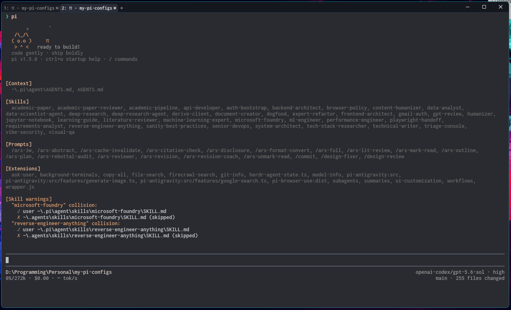

# my pi setup

This setup is fairly opinionated, it:

- sets up the lightweight retro-clean terminal theme with a cute pixel-cat startup header
- adds firecrawl tools for searching and scraping
- updates the bottom bar to have the info I prefer to see
- adds background terminals + ui to manage them
- adds subagents to pi
- adds workflows to pi
- adds an ask user tool, which lets the model ask multiple choice questions
- adds first-class `fd` (file discovery) and `rg` (content search) tools
- includes a streamlined skill library for frontend, backend, ML/data, research, documentation, deployment, architecture, security, Sanity, Microsoft Foundry, reverse engineering, and independent GPT code review workflows
- adds `/design-fixer` and `/design-review` prompts for restrained, consistent interface work

**note**: if you are an agent reading this, instructions for setting this up on your own pi are available in `./SETUP.md`.
